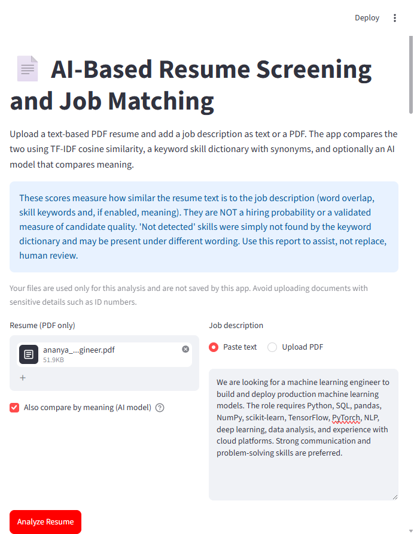
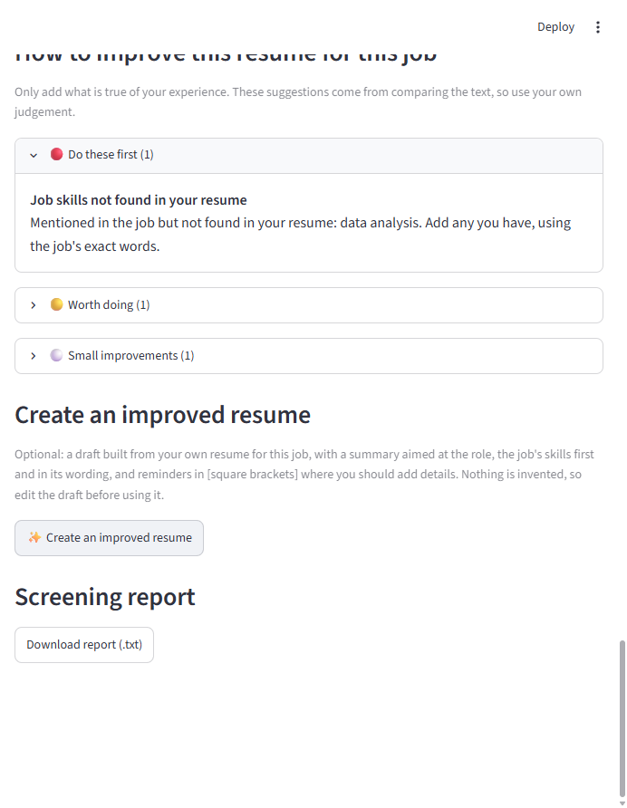
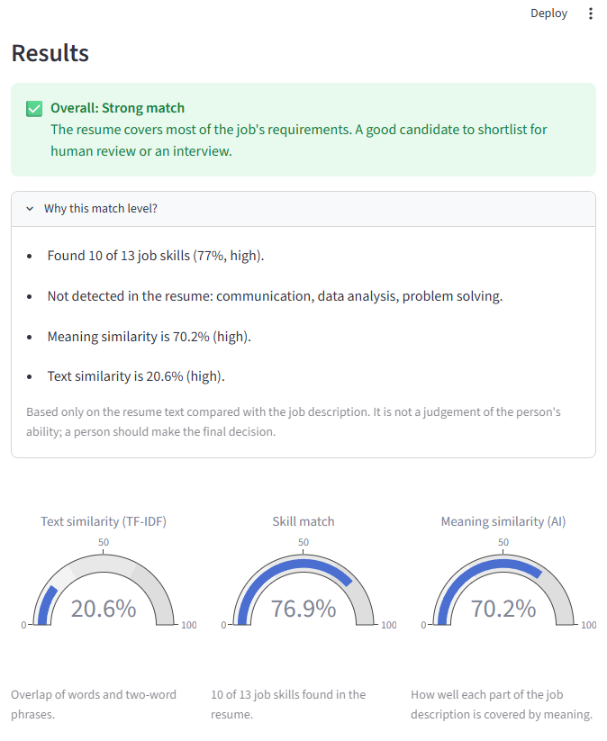
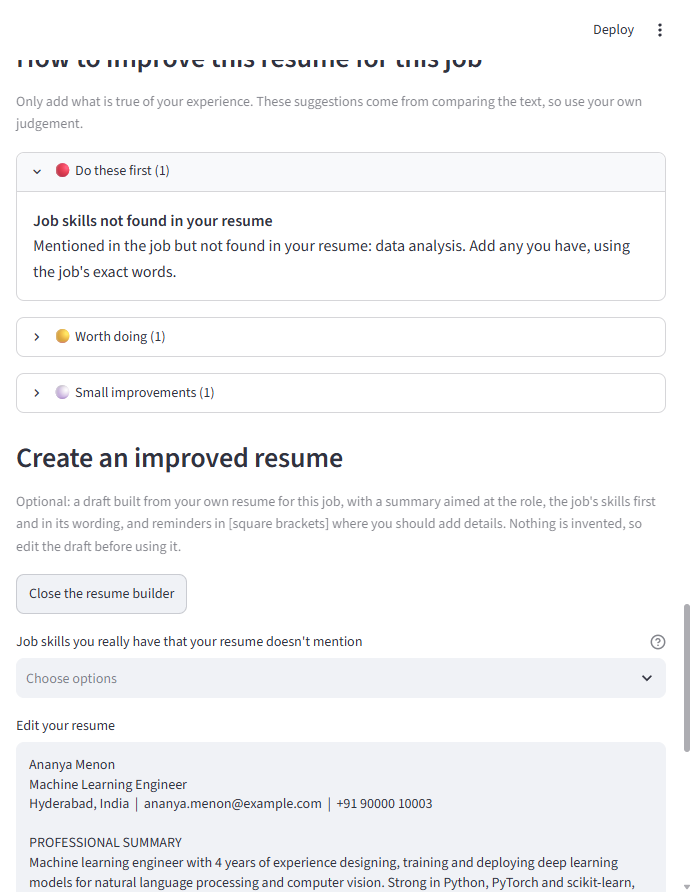

# AI-Based Resume Screening and Job Matching System

A local Streamlit app that compares a PDF resume with a job description using
TF-IDF cosine similarity, a keyword skill dictionary with synonyms, and an optional
local AI model that compares meaning. See `IMPLEMENT.md` for
the full architecture.

> The scores measure how similar the texts are. They are **not** a hiring
> probability and should assist, not replace, human review.

## Setup (Windows)

```bash
py -m venv .venv
.venv\Scripts\activate
python -m pip install --upgrade pip
pip install -r requirements.txt
streamlit run app.py
```

On macOS/Linux use `python3 -m venv .venv` and `source .venv/bin/activate`.

Open the URL shown in the terminal (usually http://localhost:8501).

## Deploying online

The app runs on [Streamlit Community Cloud](https://share.streamlit.io) for free:
choose this repository, the `main` branch and `app.py`. `requirements.txt` uses the
CPU-only build of PyTorch to keep the install small, and the AI model is downloaded the
first time someone runs an analysis, so that first run is slower. The app used about
650 MB of memory with the model loaded when measured locally. Uploads are limited to
5 MB in `.streamlit/config.toml`.

An online app runs on someone else's server, so uploaded resumes leave your computer.
The app doesn't save them, but it has no login, so anyone with the link can use it.

## Features

- **Overall match level** (Strong / Partial / Weak) with the reasons and a suggested
  next step. It describes how well the resume matches the job description, not the
  person's ability. Thresholds are in `src/verdict.py`.
- **Three scores**, each shown as a gauge:
  - *Text similarity* – TF-IDF cosine similarity (word overlap).
  - *Skill match* – the share of the job's skills found in the resume.
  - *Meaning similarity* – uses the local `all-MiniLM-L6-v2` model, so
    "built neural networks" can match "deep learning". The model (about 90 MB)
    is downloaded on first use, then runs offline. This is optional: without
    `sentence-transformers` installed, the checkbox is disabled.
- **Skill dictionary** for tech, marketing, HR, finance, design and soft skills,
  with **synonyms** (e.g. JS → JavaScript, K8s → Kubernetes, NLP → natural
  language processing). Edit `SKILL_CATEGORIES` and `SYNONYMS` in
  `src/skill_extractor.py`.
- **Chart** of matched vs not-detected job skills by category.
- **Keyword highlighting**: the resume and job description are shown side by side with
  matched skills and skills not detected marked, including synonyms.
- **Top shared keywords chart**: the words adding most to the text similarity score.
- **Job description as text or PDF**: paste it, or upload a text-based PDF.
- **Suggestions to improve the resume for this job**, ranked by importance. They use
  the job's own wording to separate required skills from optional ones, and flag:
  skills not found, skills listed but not shown in experience, different wording,
  years of experience, education, the summary, repeated keywords, and bullets without
  numbers. They run locally and are rule-based, so no AI service sees your resume.
  Only add what is true of your experience. Rules are in `src/suggestions.py`.
- **Create an improved resume** (optional, behind a button): builds a draft from your resume for this job. It adds
  a summary aimed at the role, puts the job's skills first in the job's own wording, and
  adds reminders in [square brackets] where a bullet needs a number or a skill needs an
  example. Job skills your resume doesn't mention are only added if you tick them as
  skills you really have. Edit the draft in the app, then download it as a one-column
  PDF or text file. The code is in `src/resume_builder.py`.
- **Downloadable text report** with all scores, skills and suggestions.

## Screenshots

### Application home screen


### Screening results



### Overall match, score gauges and skills chart



### Overall match detail



### Improved resume builder



## Usage

1. Upload a text-based PDF resume.
2. Paste the job description or upload it as a PDF (at least 15 words).
3. Click **Analyze Resume**.
4. Review the three scores, the skills chart, matched skills, skills not detected,
   and the suggestions for improving the resume.
5. If you want a tailored resume, click **✨ Create an improved resume**, tick any listed job skills you really have, edit
   the draft and replace the [square bracket] reminders, then download it.
6. Click **Download report (.txt)** to save the results.

## Project structure

```text
app.py                    Streamlit UI and validation
src/pdf_parser.py         PDF text extraction (pypdf)
src/text_preprocessing.py Text cleaning
src/skill_extractor.py    Skill dictionary, synonyms and matching
src/semantic_matcher.py   Meaning-based similarity (optional AI model)
src/suggestions.py        Job-specific resume suggestions
src/resume_builder.py     Improved resume draft and its PDF
src/highlighter.py        Skill highlighting in the resume and job text
src/charts.py             Plotly gauges and charts
src/matcher.py            TF-IDF + cosine similarity
src/report_generator.py   Plain-text report
tests/                    pytest unit tests
sample_data/              Sample resumes and job descriptions (short ones and
                          full-length realistic ones) and invalid files (see its README)
```

## Running tests

```bash
python -m pytest
```

## Limitations

- Scanned/image-only PDFs are not supported (no OCR), for resumes or job descriptions.
- Suggestions come from text rules, so they can miss things or misread a resume.
  They are prompts to check, not instructions.
- Two-column PDFs may extract with their columns merged. The app detects this, warns
  about it and skips advice about sections, but it does not rebuild the columns.
- The improved resume reuses your text and only rearranges and adds to it; it does not
  rewrite your sentences. For two-column PDFs whose columns merged, it adds the summary
  and skills above your original text for you to sort into sections.
- Skill detection only finds words in the dictionary; synonyms may be missed.
- TF-IDF is lexical and does not understand meaning; the AI score helps, but it
  is still a similarity measure, not a judgement of the candidate.
